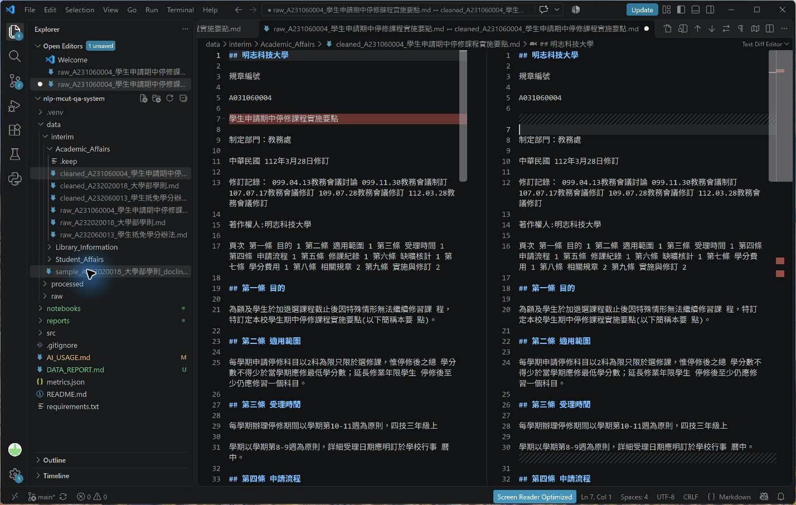
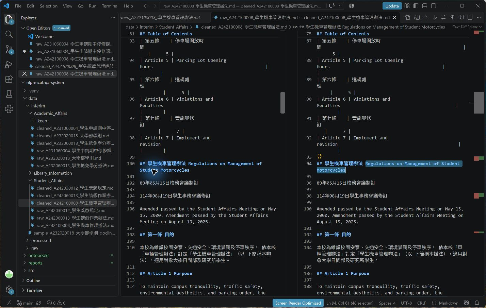
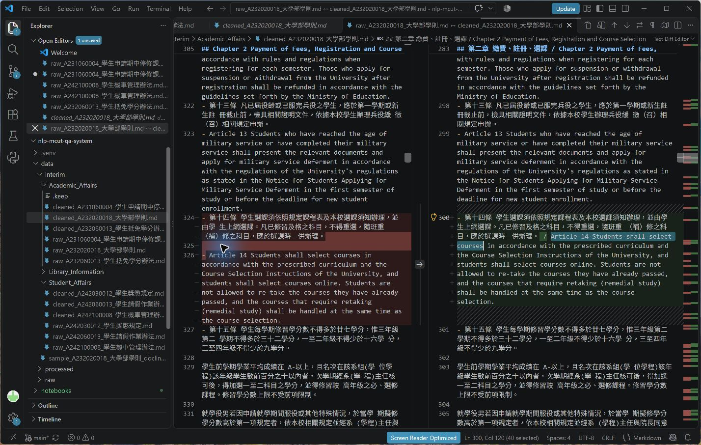
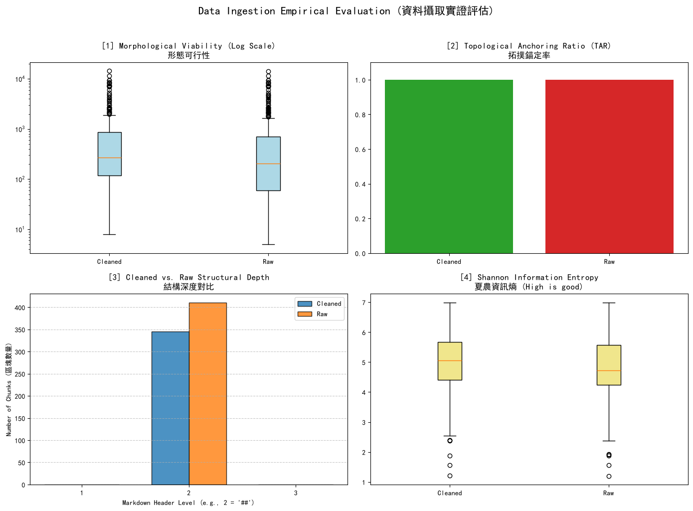

# 資料前處理報告 (Data Preparation Report)

期中評量 · NLP 自然語言處理 115-S1

- **學號 / 姓名**：U12627009 / 李宙軒
- **專案名稱**：NLP 自然語言處理課程專案（nlp-mcut-qa-system）
- **完成的任務**：- [x] 1-A 頁首頁尾清除　- [x] 1-B 雙語標題合併　- [x] 1-C 雙語條文合併

---

## 1. 資料集概覽 (Dataset Overview)

| 類別 (Cluster) | PDF 數量 | 清洗前 chunk 數 | 清洗後 chunk 數 |
|---|---:|---:|---:|
| Academic_Affairs | 3 | 96 | 65 |
| Library_Information | 3 | 248 | 225 |
| Student_Affairs | 3 | 66 | 55 |
| **合計** | **9** | **410** | **345** |

清洗後共減少 65 個 chunk（約 15.9%）。主要原因是 1-A 刪除部分以 `##` 開頭的重複文件名稱，以及 1-B 將相鄰的中英文 `##` 標題合併；兩者都會減少 `chunking_regex = r"\n(?=##\s)"` 能切到的邊界。1-C 合併的是條文文字而不是新增或刪除 `##` 邊界，因此原則上不影響 chunk 數量。

## 2. 清洗步驟 (Cleaning Steps)

### 2.1 任務 1-A：頁首頁尾溢出清除

- 檔名：`raw_A231060004_學生申請期中停修課程實施要點.md` / `cleaned_A231060004_學生申請期中停修課程實施要點.md`　搜尋的文字：`學生申請期中停修課程實施要點`
- 截圖：
- 改變了什麼：清洗程式依 PDF 檔名取出規章名稱，刪除頁面中獨立成行、重複出現的「學生申請期中停修課程實施要點」，但保留相鄰的條文與修訂紀錄。
- 這對之後的問答檢索有什麼幫助：可避免頁首頁尾文字形成內容極少的重複 chunk，也可降低同一標題在向量檢索中重複命中的機率。
- 這個任務有沒有改錯的地方：沒有發現；抽查的刪除內容都是與檔名完全相同的獨立標題行，條文內容仍保留。

### 2.2 任務 1-B：雙語標題合併

- 檔名：`raw_A242100008_學生機車管理辦法.md` / `cleaned_A242100008_學生機車管理辦法.md`　搜尋的文字：`Regulations on Management of Student Motorcycles`
- 截圖：
- 改變了什麼：原本分成三行的學校中文名稱、英文校名與英文規章名稱，被合併為同一個 `##` 標題並以 `/` 分隔。
- 這對之後的問答檢索有什麼幫助：中文或英文查詢都會命中同一個有完整雙語語境的 chunk，並避免同一文件的標題被切成多個短 chunk。
- 這個任務有沒有改錯的地方：有。`cleaned_A232020018_大學部學則.md` 搜尋 `Part 2 Undergraduate Division / Chapter 1 Admissions`，可看到父層篇名與子層章名因為都是相鄰英文標題而被誤合併，原本的層級關係被壓平。

### 2.3 任務 1-C：雙語條文合併

- 檔名：`raw_A232020018_大學部學則.md` / `cleaned_A232020018_大學部學則.md`　搜尋的文字：`Article 14 Students shall select courses`
- 截圖：
- 改變了什麼：中文第十四條與英文 Article 14 原本被空白行分隔，清洗後合併為同一段並以 `/` 連接。
- 這對之後的問答檢索有什麼幫助：同一條規定的中英文會留在同一個 chunk，能提升跨語言查詢的召回率，也減少只取到單一語言而缺少對照的情況。
- 這個任務有沒有改錯的地方：有。`cleaned_A242100008_學生機車管理辦法.md` 搜尋 `insurance certificate, / and the payment receipt`，英文句子的換行續句被誤當成雙語條文，以 `/` 錯誤連接。

## 3. 評估指標與 AI 解讀查證 (Metrics & Verifying the AI's Interpretation)

### 3.1 指標數據表

| 指標 | Raw | Cleaned (我的) | Cleaned (參考值) |
|---|---:|---:|---:|
| [1] 中位數長度 Median Length | 204.0 | 272.0 | 老師未公布 |
| [2] 拓撲錨定率 TAR | 100.00% | 100.00% | 老師未公布 |
| [3] 深度變異量 SDV (選填) | 0.00 | 0.00 | 老師未公布 |
| [4] 中位數資訊熵 Entropy (選填) | 4.71 | 5.05 | 老師未公布 |



老師今天未公布參考值，因此無法判定是否一致；上表保留我自己的實際執行結果，沒有自行推測參考值。

### 3.2 AI 的解讀

- 使用的 AI 工具：ChatGPT Codex（GPT-5 桌面版）

```text
儀表板顯示清洗後的 chunk 中位數長度由 204 增加至 272，約增加 33.3%。這與合併雙語標題及條文、減少過短碎片的方向一致，但箱形圖仍有很長的離群值，所以不能只看中位數就認定所有 chunk 都適合檢索。

Raw 與 Cleaned 的 TAR 都是 100%，表示依目前程式的定義，兩組資料的每個 chunk 都以 Markdown 標題符號開頭；清洗沒有讓這個數值進一步提高。SDV 也都是 0，表示程式量到的標題深度完全一致，但這可能只是資料全部以同一層級「##」切塊，不能證明原始文件的階層結構都被正確保留。

中位數資訊熵由 4.71 上升至 5.05，約增加 7.1%，可解讀為清洗後典型 chunk 的字元分布較多樣、重複頁首或短碎片較少；不過資訊熵只衡量字元分布，並不直接衡量語意正確性。整體而言，清洗改善了典型 chunk 的長度與資訊密度，但儀表板的離群值仍暗示表格轉換、超長 chunk 或低資訊重複內容尚未完全解決，需要回到實際檔案抽查。
```

### 3.3 你的查證 (至少兩點)

**查證 1**
- AI 的說法：清洗後的 chunk 中位數長度由 204 增加至 272，與合併及減少過短碎片的方向一致。
- 我查了什麼：查閱專案根目錄的 `metrics.json`，確認 Raw 為 204.0、Cleaned 為 272.0；再檢查 `01_Data_Ingestion.ipynb` 第 5 節的批次輸出，總 chunk 數由 410 降為 345。
- 結論：正確，因為指標與實際檔案數量都支持「chunk 變少、典型 chunk 變長」；但這不代表所有 chunk 都更好，指定的 9411 字元表格仍是明顯離群值。

**查證 2**
- AI 的說法：TAR 100% 表示依目前程式定義，每個 chunk 都以 Markdown 標題符號開頭，但不能證明階層結構正確。
- 我查了什麼：查閱 `01_Data_Ingestion.ipynb` 第 6 節的 `get_tar()`，它只用 `re.match(r'^\s*#+', record["text"])` 檢查 chunk 開頭是否有 `#`；同時在 `cleaned_A232020018_大學部學則.md` 找到 `Part 2 Undergraduate Division / Chapter 1 Admissions` 的誤合併。
- 結論：正確；TAR 的 100% 只證明每個 chunk 有標題錨點，不能檢查標題內容是否配對正確，也不能發現父層與子層標題被誤合併。

### 3.4 實際證據：你被指定的 chunk

- **SEED**：1106

**(a) 很長的 chunk**
- 資料檔 (JSON)：`data/processed/Academic_Affairs/cleaned_A232060013_學生抵免學分辦法_processed.json`　位置：第 28 個（從 0 開始數）　長度：9411 字元　驗證碼：`9ce313fb`
- 閱讀用檔案 (`.md`)：`data/interim/Academic_Affairs/cleaned_A232060013_學生抵免學分辦法.md`　從第 315 行開始
- 前 3 行內容：
  ```text
  ## 學年度第 學期

  | 系所(學 位學程)      |                      |                      |                      | 班級                 |                      |                      |                      | 學號                                                                                                                                                                                       |                                                                                                                                                                                            |                                                                                                                                                                                            |                                                                                                                                                                                            | 姓名                 | 姓名                 | 姓名                 |
  ```
- 這是什麼樣的文字？為什麼會這麼長？這是科目替代申請書的複雜表格。PDF 表格有大量合併儲存格，Docling 轉成 Markdown 時把欄位展開、重複並加入大量空白，再加上切塊規則只遇到下一個 `##` 才切開，因此整張表格成為 9411 字元的單一 chunk。
- 之後做問答檢索時，這麼長的 chunk 可能造成什麼問題？它可能超過嵌入或語言模型的有效輸入長度；即使沒有被截斷，大量重複欄位也會稀釋真正的關鍵詞，使向量表示不精確，檢索後還會佔用過多上下文空間。

**(b) 資訊熵很低的 chunk**
- 資料檔 (JSON)：`data/processed/Library_Information/cleaned_A273060005_學生電子郵件帳號管理要點_processed.json`　位置：第 3 個（從 0 開始數）　資訊熵：2.58　驗證碼：`9c82d449`
- 閱讀用檔案 (`.md`)：`data/interim/Library_Information/cleaned_A273060005_學生電子郵件帳號管理要點.md`　從第 33 行開始
- 內容：
  ```text
  ## 目錄 / Table of contents

  |                                                   |                                                   |   頁次 Page Number |
  |---------------------------------------------------|---------------------------------------------------|--------------------|
  | 第一條                                            | 目的                                              |                  1 |
  | Article 1 Purpose                                 | Article 1 Purpose                                 |                  1 |
  | 第二條                                            | 適用範圍                                          |                  1 |
  | Article 2 Scope of Application                    | Article 2 Scope of Application                    |                  1 |
  | 第三條                                            | 系統管理與處置措施                                |                  2 |
  | Article 3 System Management and Disposal Measures | Article 3 System Management and Disposal Measures |                  2 |
  | 第四條                                            | 資料運用範圍                                      |                  3 |
  | Article 4 Scope of Data Use                       | Article 4 Scope of Data Use                       |                  3 |
  | 第五條                                            | 遵守要點                                          |                  3 |
  | Article 5 Rules to be Followed                    | Article 5 Rules to be Followed                    |                  3 |
  | 第六條                                            | 處分原則                                          |                  4 |
  | Article 6 Principle of Punishment                 | Article 6 Principle of Punishment                 |                  4 |
  | 第七條                                            | 使用聲明                                          |                  4 |
  | Article 7 Statement of Use                        | Article 7 Statement of Use                        |                  4 |
  | 第八條                                            | 實施與修訂                                        |                  4 |
  | Article 8 Implementation and Amendment            | Article 8 Implementation and Amendment            |                  4 |
  ```
- 為什麼它的資訊熵這麼低？它對問答檢索有用嗎？這是一張目錄表，包含大量重複空白、表格符號、頁碼，以及重複兩次的英文條目名稱，字元分布集中所以熵低。它對「有哪些章節」或「某條在第幾頁」的問題有少量用途，但對規章內容問答幫助很小，還可能和真正的條文 chunk 競爭檢索排名。

## 4. 一個尚未解決的問題 (One Remaining Problem)

- **檔名**：`cleaned_A242100008_學生機車管理辦法.md`　**從第 124 行開始**　**標題**：`Article 2 Management Principles`
- **我是怎麼找到的**：在清洗後檔案搜尋 ` / `，發現英文句子內出現不自然的斜線；再和同名 `raw_` 檔比較，確認原始內容只是 PDF 轉換造成的換行續句。
- **問題 chunk（部分內容）**：

```text
## Article 2 Management Principles

Article 3 Regulations for Student Application for "Motorcycle Parking Permit"

2. Motorcycle parking cleaning fee refunds are processed on a semester basis. A refund of half the fee, amounting to 250 NTD, can be granted. No refund will be provided after the second semester begins.
3. Applicants must prepare a copy of their campus card, driver's license, vehicle registration, insurance certificate, / and the payment receipt for the parking cleaning fee, and complete the "Motorcycle Parking Permit Application Form" for processing at the Student Discipline Division.
```

- **問題是什麼**：`insurance certificate,` 與下一行 `and the payment receipt...` 原本是同一個英文句子的換行，1-C 卻把它當成中文／英文條文對，插入 `/`。此外 Article 3 沒有 `##`，所以它仍被包在 Article 2 的 chunk 內。
- **可能的原因**：Docling 將跨頁或版面換行轉成「一般文字＋空白行＋`- ` 英文續句」；1-C 的正則 `^([^\n]+)\n(?:[ \t]*\n)+- ([A-Za-z][^\n]*)$` 只要求第二段以英文字母開頭，沒有要求第一段是中文條文、第二段是 `Article N`，因此過度合併。
- **具體的修正方法**：把規則限制為第一段必須符合中文條號（如 `第十四條`），第二段必須以 `Article` 加數字開頭，例如先採用 `(?m)^(-?\s*第[一二三四五六七八九十百〇零\d]+條[^\n]*)\n(?:[ \t]*\n)+-\s+(Article\s+\d+\b[^\n]*)$`；對其他英文換行則只移除換行，不插入 `/`。同時應在 `Article N` 前補 `##` 或依條號重新切塊。
- **對問答檢索的影響**：錯誤斜線會改變句子語意與斷句；Article 3 被放入 Article 2 chunk 也會讓標題詮釋資料錯誤，使查詢「第三條申請規定」時降低命中率，或回傳混有第二條內容的答案。

## 5. AI 協作 (AI Collaboration)

- 本次作業的 AI 協作紀錄請見 [`AI_USAGE.md`](AI_USAGE.md) 的「Week 04 / 08」與「Week 09」段落。
- 這次使用 AI 最大的收穫或教訓是：提示詞中的「不能發生的事」與反例最關鍵。雖然 Week 08 的簡單斷言都通過，但這次回到真實檔案後，仍找到「父子標題誤合併」和「英文換行續句被插入 `/`」；另外，AI 對 TAR 100% 的解讀必須回查 `get_tar()`，因為它只代表 chunk 開頭有 `#`，不代表標題層級或內容正確。
